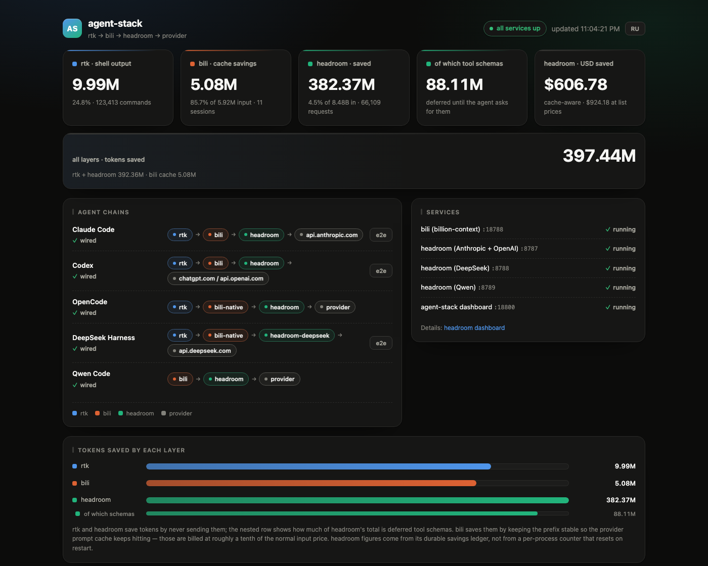

# agent-stack

<p align="center">
  <strong>Spend fewer tokens without changing how you work.</strong><br>
  One installer puts <b>rtk + bili + headroom + caveman</b> in front of
  <b>Claude Code</b>, <b>Codex</b>, <b>OpenCode</b>, <b>DeepSeek Harness</b> and <b>Qwen Code</b>.
</p>

<p align="center">
  <a href="https://github.com/flywalk4/agent-stack/stargazers"></a>
  
  
  
  
</p>

<p align="center">
  
</p>

Your agents send the same context again and again: shell output, tool results, tool
definitions, the whole conversation prefix. agent-stack removes what does not need to
go out, keeps the prefix stable so the provider's prompt cache keeps hitting, and shows
you the savings in one local dashboard.

No new client. No workflow change. Every config it edits is backed up, and
`agent-stack uninstall` puts it all back.

## Quick start

**macOS / Linux**

```bash
curl -fsSL https://raw.githubusercontent.com/flywalk4/agent-stack/main/install.sh | bash
```

Unattended — every detected agent, every layer, no prompts:

```bash
curl -fsSL https://raw.githubusercontent.com/flywalk4/agent-stack/main/install.sh | bash -s -- --yes
```

**Windows** (PowerShell 5.1+)

```powershell
irm https://raw.githubusercontent.com/flywalk4/agent-stack/main/install.ps1 | iex
```

The bootstrap installs Node.js and uv when missing (brew on macOS, apt on
Debian/Ubuntu, winget on Windows), then runs the interactive installer:

1. **Install / update** or **Uninstall** — asked first, so one checkout can do both.
2. Which agents to wire up — <kbd>space</kbd> selects, <kbd>enter</kbd> continues.
3. Which layers to install — same keys.
4. A plan summary, then a confirmation.

From a checkout, `./install.sh` or `./install.ps1` does the same. The non-interactive
path is `agent-stack install --yes`; prompts need a TTY, and without one the installer
exits with a hint instead of hanging.

## What each layer saves

```
agent  →  rtk  →  bili  →  headroom  →  provider
          │       │         │
          │       │         └─ compresses tool results, defers tool schemas
          │       └─ folds session context, keeps the prefix cache-hot
          └─ shrinks shell output inside the agent (hooks / rules / skills)
```

Measured on one working install, as shown on the dashboard:

| Layer | Where it runs | What is saved | Share |
|---|---|---|---|
| **rtk** | inside the agent | Shell output, shrunk before it enters the context | **24.8%** of shell output |
| **bili** | local proxy `:18788` | Stable prefix, so the provider prompt cache keeps hitting | **~85%** of input served from cache |
| **headroom** | local proxy `:8787` | Compressed tool results and deferred tool schemas | **4.5%** of request tokens; **~23%** of that is schemas |
| **caveman** | inside the agent | Terse answers by default | fewer output tokens |

rtk and headroom save tokens by never sending them. bili saves money a different way:
the tokens do go out, but hit the provider prompt cache, which is billed at roughly a
tenth of the normal input price. The dashboard adds the layers up but keeps those two
kinds of saving apart, and shows headroom's schemas as a nested row because they are
part of its total, not an extra layer.

## Supported agents

| Agent | Chain |
|---|---|
| **Claude Code** | rtk → bili `:18788` → headroom `:8787` → api.anthropic.com |
| **Codex** | rtk → bili `:18788` → headroom `:8787` → chatgpt.com / api.openai.com (HTTP, no WebSocket) |
| **OpenCode** | rtk → bili-native (in-process) → headroom transport plugin → `:8787` → provider |
| **DeepSeek Harness** | rtk → bili-native (dsh bundle) → headroom `:8788` → api.deepseek.com |
| **Qwen Code** | bili `:18788` → headroom `:8787` → the gateway named by the selected route |

Qwen has two routing modes, because its config has two shapes. Routes under
`modelProviders[]` and the legacy `model.baseUrl` accept
`generationConfig.customHeaders`, so they share headroom `:8787` and carry the original
gateway in `x-headroom-base-url`. The newer top-level `providers` registry has no
headers field, so agent-stack runs a dedicated headroom on `:8789`, pinned to that
gateway with `--openai-api-url`. rtk has no Qwen hook, so Qwen's chain starts at bili.
Add a route and re-run `agent-stack install` to wire it.

## Commands

| Command | What it does |
|---|---|
| `agent-stack install [--yes]` | Interactive setup; also runs when no command is given. Asks install or uninstall. |
| `agent-stack doctor [--json]` | Services, agent configs and end-to-end chain probes. Exit code 1 if anything is down. |
| `agent-stack dashboard` | Opens the shared dashboard at <http://127.0.0.1:18800>. |
| `agent-stack uninstall` | Removes the services and restores every changed config from the backups. |

## Dashboard

<http://127.0.0.1:18800> — served by the dashboard service.

- Tokens saved per layer, the combined total, and the USD figure.
- Live agent chains with hop health, service status, and a one-click `e2e` probe that
  sends a bogus-key request through the whole chain. A provider-shaped `401` means the
  chain works and no tokens were spent.
- Recent bili sessions.
- **English by default**, with an **RU** toggle in the header (`localStorage`, per browser).

headroom figures come from its durable savings ledger
(`~/.headroom/savings_events.jsonl`, the file `headroom savings` aggregates), not from
`/stats`: those counters live in `~/.headroom/proxy_savings.json`, are rewritten
wholesale by whichever proxy saves last, and freeze while requests keep flowing. Each
proxy gets its own `HEADROOM_SAVINGS_PATH`; the append-only ledger stays shared.

## Why it is wired this way

- **bili before headroom.** bili keeps a stable prefix for the prompt cache; headroom
  runs in `cache` mode, compresses only the delta, and never busts that prefix.
- **rtk and caveman live inside the agent** (hooks, rules, skills), not on the network.
  caveman's own `caveman claude` launcher is deliberately not installed — it would add a
  fourth network hop.
- **Codex without WebSocket.** On the WS transport both bili and headroom rewrite
  `previous_response_id`, and Codex fails with `previous_response_not_found`.
- **A separate headroom for DeepSeek** (`--openai-api-url https://api.deepseek.com`
  `--anthropic-api-url https://api.deepseek.com/anthropic`), so Codex's OpenAI traffic
  never lands on DeepSeek. Both upstreams are needed: the harness speaks Anthropic
  Messages, and without the Anthropic URL headroom would forward DeepSeek keys and
  payloads to api.anthropic.com.
- **DeepSeek Harness is patched, not reconfigured.** Each mounted DeepSeek route gets one
  entry in `~/.dsh/profiles/<name>/cordis.patch.yml` — `llm-deepseek` (`baseURL`) and
  `llm-deepseek-account` (`inferenceOrigin`) — both pointed at headroom `:8788`. The
  patch is idempotent and the harness picks it up without a restart.

<details>
<summary><b>OpenCode: why a directory, and why both plugin APIs</b></summary>

OpenCode V2 silently drops a configured `.js` path (`configured plugin path must be a
directory`) and resolves a plugin directory through its own `package.json`. agent-stack
therefore generates `~/.config/opencode/plugins/agent-stack-headroom/` — a wrapper
around the transport plugin headroom ships inside its uv tool — and points the config at
that directory, which the V1 line loads just as well. Legacy
`…/plugins/<name>/<file>.js` entries are rewritten to their parent directory, and the
entry is written back into whichever key the config already uses (`plugins` on V2-line
configs, `plugin` otherwise).

Both plugins are dual-API (`server()` + `setup()`). Upstream ships headroom's transport
and caveman's plugin for the V1 hook API only, so agent-stack adapts both: the generated
headroom wrapper default-exports `{ id, server, setup }`, and caveman's installed
`plugin.js` is patched to the same shape. On the V1 line the plugin object is loaded
through more than one lane (1.18.29+ calls `server()`, its native lane calls `setup()`),
so the wrapper installs the fetch transport exactly once per process and releases it
once. Every V2 registration is guarded by a `typeof ctx.x?.y === 'function'` check, so a
build without that seam stays inert instead of crashing. `agent-stack doctor` reports
both (`caveman: plugin runs on both plugin APIs`, `headroom: transport wrapper runs on
both plugin APIs`); a caveman self-update overwrites `plugin.js`, and the next
`agent-stack install` re-applies the patch.

</details>

<details>
<summary><b>Services and platform details</b></summary>

- **macOS** — launchd user agents `dev.agent-stack.*` in `~/Library/LaunchAgents`, logs in
  `~/Library/Logs/agent-stack/`. Each plist carries an explicit `PATH` (brew, cargo, uv,
  `~/.agent-stack/bin`, …) so launchd jobs can find binaries such as `rtk`.
- **Linux** — systemd user units `dev-agent-stack-<name>.service` in
  `~/.config/systemd/user/`, enabled with `systemctl --user enable --now`, logs appended to
  `~/.agent-stack/logs/<name>.log` and mirrored into the journal
  (`SyslogIdentifier=agent-stack-<name>`). The unit restarts on failure and stops with
  `SIGTERM`/20 s so bili can flush its sessions. On a server, enable lingering once:
  ```bash
  sudo loginctl enable-linger "$USER"
  systemctl --user status dev-agent-stack-bili
  journalctl --user -u dev-agent-stack-headroom -f
  ```
  Run as root without a user manager, the installer writes system-wide units to
  `/etc/systemd/system/`; `uninstall` removes whichever scope it finds.
- **Windows** — Task Scheduler tasks `agent-stack-*`, started at logon, hidden window,
  auto-restart. Logs in `%USERPROFILE%\.agent-stack\logs`.

Hand-made `bili` / `headroom` services that would fight for the ports are detected and
renamed to `*.disabled-by-agent-stack` during install.

`launchctl bootstrap` can report `Bootstrap failed: 5: Input/output error` even though the
job loads: launchd tears the old job down asynchronously and it stays visible to
`launchctl print` for a moment. The installer waits for the label to really disappear
before bootstrapping, retries the pair if needed, and confirms the job is still loaded
before reporting success.

</details>

<details>
<summary><b>Linux troubleshooting</b></summary>

| Symptom | Fix |
|---|---|
| `systemd user manager is not reachable` | `sudo loginctl enable-linger "$USER"`, log in again, re-run `agent-stack install` |
| Services disappear after logout | lingering is off: `loginctl show-user "$USER" --property=Linger` |
| Container without systemd | run the installer as root — it falls back to system units in `/etc/systemd/system` |
| A service does not come up | `systemctl --user status dev-agent-stack-bili`, `journalctl --user -u dev-agent-stack-bili -n 50` |
| `npm i -g billion-context` needs a compiler | `sudo apt-get install -y build-essential python3` |
| `rtk: command not found` inside a service | the unit's `PATH` includes `~/.agent-stack/bin`; check the path `agent-stack doctor` reports |

</details>

## Backups and uninstall

Every config agent-stack touches is copied **once** to `~/.agent-stack/backups` (with a
`manifest.json`) before the first change, so the backup always holds the state from
before agent-stack. `agent-stack uninstall` removes the services and puts those files
back. The tools themselves (rtk / bili / headroom) are left installed.

## Requirements

- macOS, Debian/Ubuntu (anything with a systemd user manager), or Windows
- Node.js ≥ 20, uv, git — the bootstrap installs them when missing
- brew (macOS) / apt (Debian, Ubuntu) / winget (Windows) for dependencies

## Repository layout

```
bin/agent-stack.js     CLI entry point
install.sh             bootstrap for macOS / Debian / Ubuntu (node + uv, then the installer)
install.ps1            bootstrap for Windows
src/install.js         interactive installer and uninstaller
src/topology.js        ports, service definitions and each agent's chain (single source of truth)
src/services.js        launchd / systemd / Task Scheduler service management
src/status.js          stats collection for the dashboard and doctor
src/doctor.js          service, config and end-to-end checks
src/tools.js           rtk / bili / headroom install and agent-side add-ons
src/caveman.js         caveman rules, hooks and skills
src/targets/*.js       per-agent config writers (claude, codex, opencode, dsh, qwen)
src/dashboard/         dashboard HTTP server and its single-page UI
test/                  node:test suites
docs/                  README assets
```

## License

MIT
